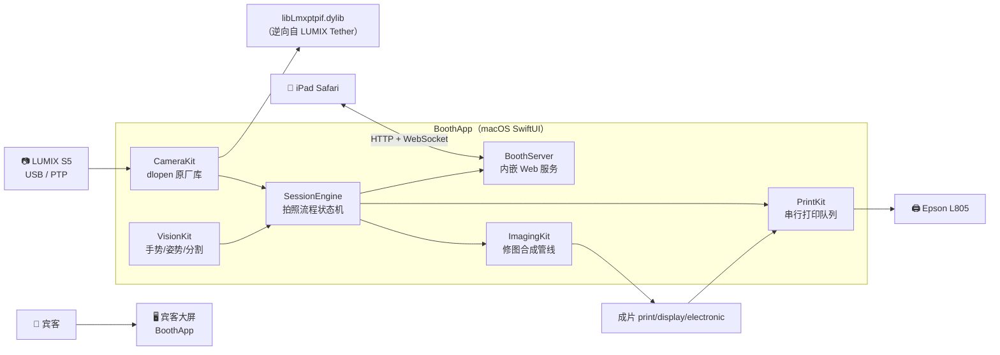

<div align="center">


# LUMIX Photobooth

**运行在 macOS 上的婚礼自助拍照亭 · Swift 6 / SwiftUI 原生**

[](https://www.swift.org)
[](https://www.apple.com/macos/)
[](Package.swift)
[](Tests)
[](SPEC.md)

宾客对着 Lumix 相机比个 ✌️ → 倒计时连拍 → 自动修图（美肤/换背景/搞怪装饰/GIF）
→ iPad 确认选张数 → Epson 6 寸现场出片 → 扫码带走电子版。

</div>

---

## 它能做什么

- **手势 / 姿势触发拍照**：人站好（Vision 人体+人脸就绪检测）→ 比耶或挥手触发倒计时；空格键随时兜底手动开拍
- **单张直出 与 大头贴拼版双模式**：经典 4 格拼条 / 2×2 四宫格 / 双格大图，开拍前点屏可选
- **自动修图管线**：调色 + 美肤 + Vision 人像分割换背景（无需绿幕）+ 主题边框水印 + 拍后自选 7 种滤镜（含 💄 妆照 Glam）+ Boomerang 动图
- **搞怪大头贴装饰**：人脸关键点驱动的贴纸/形变模板（胡子、礼帽、头纱、双囍……自带 5 套婚礼模板）
- **iPad 全程陪伴**：内嵌 HTTP+WebSocket 服务，实时取景、倒计时同屏、确认选张数、相册回看、放映页轮播、扫码存电子版、视频留言簿
- **现场运营完备**：串行打印队列 + 打印配额、PIN 门禁 + 一键重置、健康监控（相机/打印机/磁盘）、邮箱线索采集、无人值守防呆、待机省电

## 硬件要求

| 设备 | 要求 |
|---|---|
| 主机 | Mac，macOS 14+，Apple Silicon 优先 |
| 相机 | Panasonic Lumix S5，USB 连接，机身菜单 USB 模式设为 **Tether** |
| 打印机 | Epson L805 系列（系统已装驱动），默认 6 寸无边距 |
| 确认屏 | iPad Safari 访问 Mac 局域网地址（同一 Wi-Fi 即可） |

> 没有硬件也能玩：`make run-mock` 用合成相机 + 视觉自动命中 + 打印落 PDF，完整跑通全流程演示。

## 快速上手

```bash
# 构建 + 全量测试
make verify

# 无硬件演示（合成相机，自动走完 armed→gesture→countdown→capture→review→printing）
make run-mock

# 以 .app 形态演示（有 bundle id，双击可再开）
make run-mock-app

# 真机开发参考：先用 Python 脚本验证相机链路（枚举/预览/拍照）
python3 lmx.py            # 枚举设备
python3 lmx.py --lv       # 预览 10 帧 JPEG
python3 lmx.py --shot     # 拍照 + 下载落盘
```

App 内流程：**宾客大屏**全屏显示（取景/倒计时/成片），**Esc** 退出全屏进**操作员页**（状态/设置/历史/日志四个标签），**空格**手动触发拍摄，**R** 重拍，**P** 确认页直接打印。

## 架构总览



所有模块只通过 [BoothCore 协议](Sources/BoothCore/Protocols.swift)（接口宪法）与 SessionEngine 组装，测试全部可 Mock；依赖严格单向，零第三方包。

详细设计见文档：**[模块架构](docs/architecture.md)** · **[拍照流程与状态机](docs/photoflow.md)** · **[iPad Web 服务与接口](docs/server-api.md)** · **[现场运营与部署](docs/operations.md)** · **[产品与技术规格](SPEC.md)**

## 目录结构

```
booth/
├── Package.swift                # SwiftPM 多 target（8 模块 + 7 组测试）
├── SPEC.md                      # 产品与技术规格书
├── docs/                        # 项目文档（含 mermaid 图）
│   ├── architecture.md          #   模块架构与并发模型
│   ├── photoflow.md             #   拍照流程状态机与修图管线
│   ├── server-api.md            #   iPad Web 服务接口
│   ├── operations.md            #   现场运营与部署指南
│   └── images/                  #   README banner 等品牌素材
├── Sources/
│   ├── BoothCore/               # 协议/模型/配置/日志/事件总线（地基）
│   ├── BoothUI/                 # 设计系统：主题与可复用组件
│   ├── CameraKit/               # LUMIX 相机桥接（dlopen libLmxptpif.dylib）
│   │   └── libLmxptpif.dylib    #   原厂库（universal，逆向自 Tether v2.12）
│   ├── VisionKit/               # 手势/姿势/人像分割/人脸关键点（Apple Vision）
│   ├── ImagingKit/              # 修图合成：调色美肤/换背景/装饰/拼版/GIF
│   ├── PrintKit/                # CUPS 打印队列 + Mock/Preview 后端
│   ├── BoothServer/             # Network.framework 手写 HTTP + WebSocket
│   ├── SessionEngine/           # SessionCoordinator 状态机（编排中枢）
│   └── BoothApp/                # 宾客大屏 + 操作员页（SwiftUI）
├── Tests/                       # 每模块独立测试 target（相机/打印全 Mock）
├── tools/                       # 主题/装饰素材安装脚本
├── assets/                      # 内置主题（cream-wedding）与装饰模板
└── lmx.py                       # 相机逆向验证脚本（ctypes 直调，开发参考）
```

## 无硬件演示（Mock 模式）

启动参数 `-mock` 开启，用于 UI 开发、活动彩排与无人值守演示：

- **相机**：MockCameraService 产合成 LiveView 帧流与"成片"（渐变 + 帧号），支持延迟/失败注入
- **视觉**：Mock 手势/就绪检测恒定命中，空格/点击开始后自动走完全链路，review 超时自动回到 idle 循环演示
- **打印**：强制 PreviewPrintBackend 不触碰 CUPS，1200×1800 打印位图包成 N 页 4×6 英寸 PDF 落到 `~/Library/Application Support/Booth/print-preview/`（`make open-prints` 直达）
- **真机打印 dry-run**：操作员页 → 打印设置 → 「演示模式」开关（`printing.dryRun`，热更新即时生效）

窗口标题带 `[Mock]` 后缀便于区分真机。

## 数据与日志

| 内容 | 位置 |
|---|---|
| 配置 | `~/Library/Application Support/Booth/config.json` |
| 成片会话 | `~/Library/Application Support/Booth/sessions/<日期>/<会话id>/` |
| 主题 / 装饰模板 | `~/Library/Application Support/Booth/themes/` 与 `decorations/` |
| 打印预览 PDF | `~/Library/Application Support/Booth/print-preview/` |
| 操作员 PIN | 哈希独立存储（一键重置配置不会冲掉密码） |
| 日志 | `~/Library/Logs/Booth/booth-<日期>.log`（`make log` 跟踪） |

## 开发要点与风险

- **非公开 API**：`libLmxptpif.dylib` 为逆向所得（v2.12 实测可用），LUMIX Tether 升级可能变签名；最坏情况按已还原的 PTP opcode 自实现传输层。自用 License 风险低，商用需评估 EULA
- **拍照就绪信号**：`Reg_NotifyCallback(0x10000040, cb)`，回调 `param` 即新照片 handle；预览帧轮询 `Mnt_Get_LiveView_data`，忙时返回 `0x40004` 属正常
- **多相机**：所有 API 以 `uuid` 路由，架构上支持；v1 仅接一台
- **逆向分析产物**（ANALYSIS.md / 反编译伪代码 / IDA 数据库）不在仓库内，保留在 `../booth-analysis/`（开发参考，非运行时依赖）
- 常见坑（dylib 签名 / 无边距打印 / 光线复杂手势识别）与降级策略详见 [docs/operations.md](docs/operations.md)
