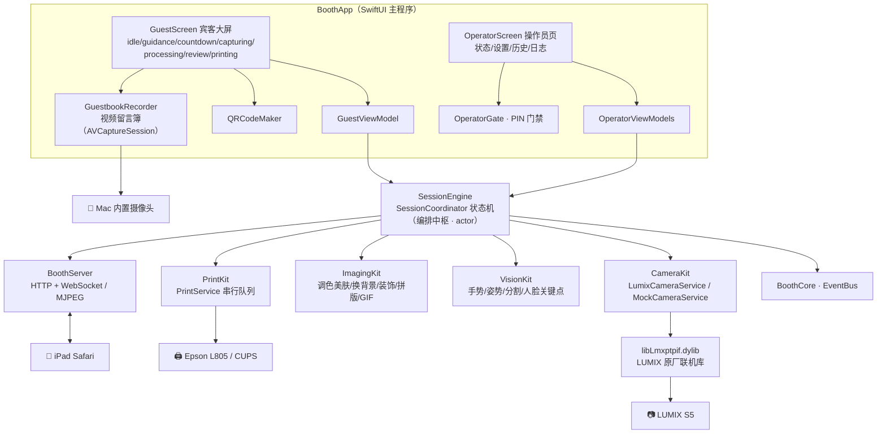
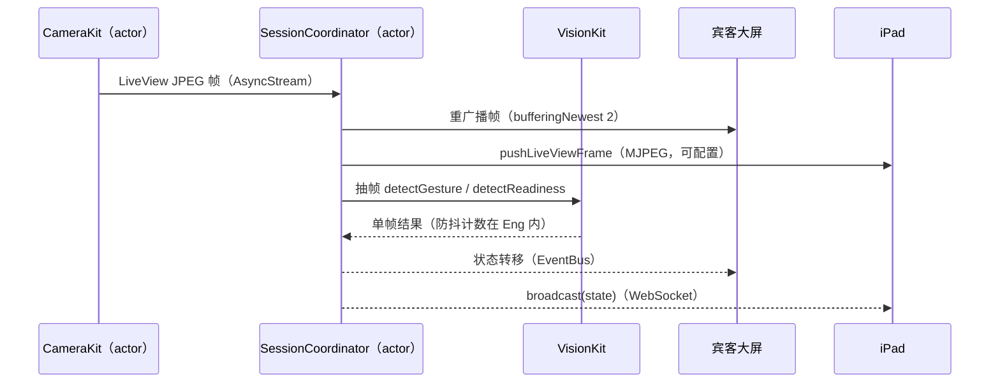
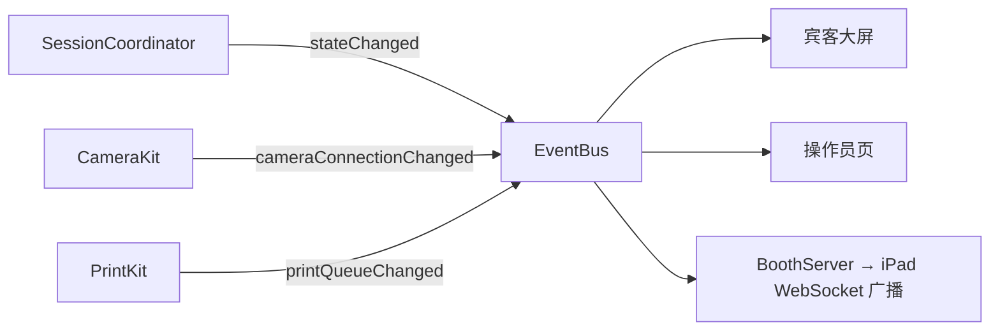

# 模块架构

> 本文描述 booth 的模块划分、依赖契约与并发模型。产品需求与里程碑见 [SPEC.md](../SPEC.md)，拍照流程细节见 [photoflow.md](photoflow.md)。

## 1. 总体架构



## 2. 依赖方向与契约

依赖严格单向：`BoothApp → SessionEngine → {CameraKit, VisionKit, ImagingKit, PrintKit, BoothServer} → BoothCore`。模块之间**互不 import**，只依赖 [Sources/BoothCore/Protocols.swift](../Sources/BoothCore/Protocols.swift) 中的协议（"接口宪法"）：

| 协议 | 实现方 | 职责 |
|---|---|---|
| `CameraServicing` | CameraKit | 连接生命周期 / LiveView 帧流 / 拍摄下载 / 事件流，必须 actor 串行化（dylib 非线程安全） |
| `GestureDetecting` | VisionKit | 单帧手势检测（✌️ / 张开手掌），连续帧防抖由 SessionEngine 负责 |
| `PoseReadinessDetecting` | VisionKit | 人体+人脸同帧就绪检测 |
| `PersonSegmenting` | VisionKit | 成片人像分割 matte（换背景用） |
| `FaceLandmarking` | VisionKit | 人脸关键点几何（搞怪装饰用），无人脸返回空数组上层降级 |
| `ImagingServing` | ImagingKit | 修图合成管线 + 拍后滤镜重打 + QR 叠印 |
| `PrintServing` | PrintKit | 串行打印队列（submit/retry/remove + 队列快照流） |
| `BoothWebServing` | BoothServer | iPad 页面路由 / 状态广播 / MJPEG 推流 / 指令流 |

这套契约的直接收益是**测试性**：7 个测试 target 全部用 Mock 实现注入，无相机、无打印机、无网络也能跑全量测试（`make verify`）。

## 3. 并发模型

- **Swift 6 严格并发**，模块内核心组件均为 actor 或内部串行化
- `SessionCoordinator` 是全 App 编排中枢（actor）：唯一消费 `camera.liveViewFrames` 帧流，职责三分发——UI 重广播（bufferingNewest(2)）、iPad MJPEG 推流（配置开关）、抽帧做手势/姿势检测
- CameraKit 收敛在串行 actor 内：C 回调线程只把事件投递进 actor 队列，不做任何业务
- PrintKit 为全局串行队列 actor，先进先打，失败保留任务可重试
- 断线/超时均以 Task 守护实现：armed/gestureWait/review 超时、failure/printing 停留计时、相机指数退避重连



## 4. 事件与状态广播

状态每次转移同步四路：`Log.session` 日志 / 内部状态流 / EventBus / BoothServer 广播。UI 与 iPad 永远同屏同步，EventBus 还承载相机连接状态与打印队列变化：



## 5. 落盘布局

统一由 [BoothCore/Paths.swift](../Sources/BoothCore/Paths.swift) 收口：

```
~/Library/Application Support/Booth/
├── config.json            # 配置（十大节，全字段可缺省向后兼容）
├── pin.hash               # 操作员 PIN 哈希（独立于 config，防一键重置误删）
├── sessions/<yyyy-MM-dd>/<HHmmss-短id>/
│   ├── 原图（JPEG）+ print-base.jpg + print.jpg / display.jpg / electronic.jpg
│   ├── print-qr.jpg（QR 叠印版）+ boomerang.gif（可选）
│   └── meta.json
├── themes/<主题名>/        # theme.json 配色 + icons/ 图标
├── decorations/<模板名>/   # template.json + 贴纸 PNG
├── guestbook/             # 视频留言簿 mp4
├── print-preview/         # dry-run 打印 PDF
└── health.json            # 健康快照（崩溃后仍可查最后一次）

~/Library/Logs/Booth/booth-<yyyy-MM-dd>.log
```

配置十大节：`camera / capture / vision / imaging / printing / server / security / sounds / share / guestbook`，操作员页修改即热更新，无需重启。完整配置项说明见 [operations.md](operations.md#3-关键配置项)。

## 6. 启动组装

`BoothApp` 按"协议 → 实现"组装整套依赖：`-mock` 启动参数把 CameraService 换成 MockCameraService、视觉换成恒定命中的 Mock 检测器、打印强制 PreviewPrintBackend，其余代码路径完全一致——mock 不是平行世界，而是同一套状态机的另一组实现注入。
