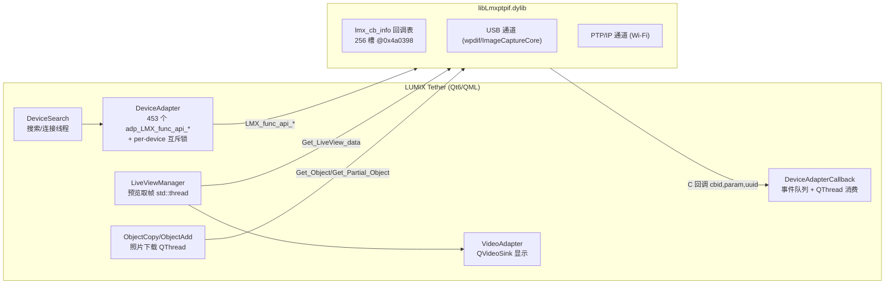

# LUMIX Tether v2.12 (macOS) 逆向分析 · 总览与阅读指南

> 分析对象：LUMIX Tether v2.12 官方 macOS 版（Qt6/QML 应用）
> 分析目的：完整还原「连接 → 事件 → LiveView 预览 → 拍照 → 照片下载」全链路，
> 为 `~/src/booth`（Swift photobooth，已有 `lmx.py` ctypes 绑定与 `Sources/CameraKit/` Swift 绑定）的移植提供依据。
> 方法：pkg 解包 → 主程序 arm64 切片 headless IDA 9.3 批量反编译（170+ 函数）→ libLmxptpif.dylib 经 IDA MCP（127.0.0.1:13337）交叉验证。

---

## 1. 样本与产物

| 产物 | 位置 |
|---|---|
| 官方 pkg 原包 | `~/Downloads/LUMIXTether_v2_12.pkg` |
| 解出的 .app | `/tmp/lumix-pkg/app/LUMIX Tether.app`（临时，重启即失） |
| 主程序 arm64 切片 | `/tmp/LumixTether_arm64`（12MB，未 strip，imagebase `0x100000000`） |
| 核心动态库 | `Contents/Frameworks/libLmxptpif.dylib`（6.9MB universal，与 `~/src/booth/Sources/CameraKit/libLmxptpif.dylib` 同源） |
| 主程序反编译产物 | 本目录 `decompiled/*.c`（约 170 函数，`*.xrefs.txt` 为调用者清单） |

**地址约定**（全文统一）：

- 主程序函数地址按 arm64 切片运行时地址书写（形如 `@0x100009bac`），换算 IDA 偏移时减去 `0x100000000`。
- libLmxptpif.dylib 函数地址按 arm64 切片文件内偏移书写（形如 `@0x495a0`），符号可直接在 `nm -arch arm64` 输出中对照。
- 反编译源文件命名：`{类/方法缩写}_{地址低位hex}.c`，如 `LVM_LiveGetThreadFunc_d7a34.c` = LiveViewManager::LiveGetThreadFunc @0x1000d7a34。

## 2. 报告索引

| 报告 | 内容 |
|---|---|
| [01-connection.md](01-connection.md) | 设备搜索、连接线程、SelectPnPDevice、OpenSession、关闭流程，PnP 信息缓冲区布局 |
| [02-events.md](02-events.md) | 三层事件架构（SDK 回调 → 事件队列 → 消费线程）、CBID 静态表完整 dump、官方 78 个注册事件 |
| [03-liveview.md](03-liveview.md) | LiveView 启动/停止线程模型、30fps 取帧循环、JPEG 解码与 multiview 合成、Qt 显示管线 |
| [04-capture-download.md](04-capture-download.md) | REC_CTRL 拍照命令族、ObjectAdded → ObjectCopy/ObjectAdd 下载线程、JPEG 整包 / RAW 分段下载 |
| [05-liblmxptpif.md](05-liblmxptpif.md) | libLmxptpif 内部协议层：PTP opcode（0x9102/0x9404/0x9412）、USB(wpdif/ImageCaptureCore)/PTPIP 双通道、错误码 |
| [06-porting-guide.md](06-porting-guide.md) | 官方行为 vs booth 现状逐项对照与移植建议 |

## 3. 官方程序总体架构

主程序命名空间 `lumixtether`，与移植直接相关的五个组件：

关键事实（各报告详述）：

1. **所有 SDK 调用都经 `DeviceAdapter` 的 `adp_LMX_func_api_*` 包装**（453 个方法），每个调用前后 `dev_mutex_lock/unlock`（per-device 互斥锁）串行化。官方**不**把调用收敛到主线程——LiveView 取帧线程、下载 QThread、事件消费 QThread 都直接调 SDK，仅靠互斥锁串行。
2. **事件是推模式**：SDK 内部线程触发 C 回调 → `registerCallback` 只做入队（绝不在回调里调 SDK）→ 专用 QThread 10ms 轮询消费，按 CBID 分发给约 70 个处理器。
3. **LiveView 是轮询模式**：不依赖事件，专线程以 ≤30fps 调 `LMX_func_api_Get_LiveView_data`，返回 JPEG 字节流直接 `QImage::fromData(buf, size, "JPG")` 解码。
4. **拍照是事件驱动**：发 `REC_CTRL{param=0x3000011}` vendor 命令 → 等 `ObjectAdded(0x10000040)` 事件（param=object handle）→ 起下载线程。JPEG 整包 `Get_Object`，RAW 按 30MB 分段 `Get_Partial_Object`。
5. **库内 USB 通道基于 macOS ImageCaptureCore**（`Bridge::getInstance()->getDeviceList()`），PTP/IP 通道为纯 socket 实现，两者在 `LMX_func_api_*` 层按 `Get_Conn_Type()==1` 自动分流。

## 4. 与 booth 现有绑定的符号对照速查

| 功能 | 官方主程序用的 API | booth 绑定的 API | 差异 |
|---|---|---|---|
| 取 LiveView 帧 | `LMX_func_api_Get_LiveView_data`（10 参数，@0x495a0） | `LMX_func_api_Mnt_Get_LiveView_data`（4 参数，@0x49388） | **不同符号**；官方用完整版（多直方图/姿态/水平仪输出），booth 用精简版，两者都有效 |
| 拍照 | `LMX_func_api_Rec_Ctrl_Release`（REC_CTRL{0x3000011}） | `LMX_func_api_StilLCapture_Single`（@0x19604） | **不同符号**；官方不使用 StilLCapture_Single（详见 04/06 报告） |
| RAW 下载 | `LMX_func_api_Get_Partial_Object`（@0x18b40）分段 | 未绑定 | RAW/大文件需分段（见 04） |
| 事件注册 | `LMX_func_api_Reg_NotifyCallback`（@0x44450） | 同 | 一致 |
| 会话 | `LMX_func_api_OpenSession`（@0x4b078） | 同 | 一致 |

## 5. 复现方法备忘

- 解包：`xar -xf LUMIXTether_v2_12.pkg` → Payload 目录 → `cat Payload | cpio -id` （注意先清理残留目录）。
- 主程序切片：`lipo -thin arm64 "LUMIX Tether" -output /tmp/LumixTether_arm64`。
- 批量反编译：`idat -A -B -S<idapython脚本> <binary>`，脚本按 nm 符号清单逐个 `ida_hexrays.decompile()` 落盘（本目录 `decompiled/`）。
- 库侧验证：IDA 打开 dylib 后经 IDA MCP hub 连接（`instance='127.0.0.1:13337'`），用 `decompile`/`py_eval` dump。
