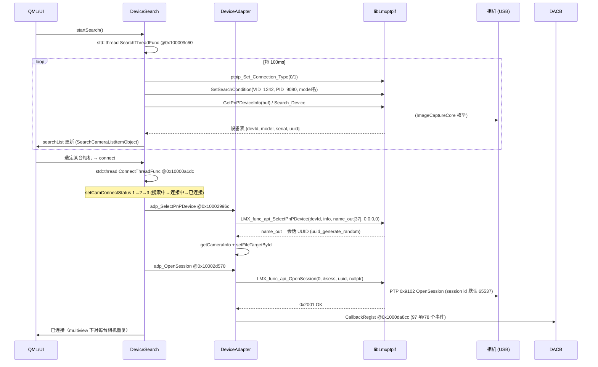

# 01 · 连接与设备管理流程

> 代码位置约定：主程序 = arm64 切片运行时地址（imagebase `0x100000000`）；
> 库 = libLmxptpif.dylib arm64 文件偏移。反编译源见 `decompiled/`。

官方连接链路一图流：



---

## 1. 库初始化与终止

| 函数 | 地址 | 说明 |
|---|---|---|
| `adp_Init` | 主 `@0x100028964` | `LMX_func_api_Init()`；随后 `adp_Set_Awake_Msg @0x100028a7c`（唤醒参数）等初始化 |
| `adp_Finish` | 主 `@0x100031834` | `LMX_func_api_Finish(&err)`，进程退出时调用 |
| `adp_DbgLog_Config` | 主 `@0x100028b5c` | 日志开关，SDK 有 `Lmx_lib_dbg_Disp_Insert_StringF` 系列内部日志 |

booth 对应：`LumixCameraService.connect()` 第 1-2 步（`lib.Init()` + 事件注册），与官方一致。

## 2. 搜索线程（DeviceSearch）

**入口** `DeviceSearch::startSearch` @主`0x100009bac` —— 起一个 `std::thread` 跑 `SearchThreadFunc`；`stopSearch` @主`0x100009a7c` 置取消标志并 join。

**搜索循环** `SearchThreadFunc` @主`0x100009c60`（源：`decompiled/DS_SearchThreadFunc_9c60.c`）：

```c
while (!IsConnectTreadCancel()) {
    ptpip_Set_Connection_Type(conn_type);        // 0=USB, 1=PTP/IP
    LMX_func_api_SetSearchCondition(...);       // VID/PID/型号过滤
    LMX_func_api_GetPnPDeviceInfo(buf);         // 或 Search_Device
    // 解析 buf → SearchCameraListItemObject 列表 → searchList 属性通知 QML
    sleep(100ms);                               // 100ms 轮询
}
```

要点：

- **100ms 轮询枚举**，不是事件驱动。相机插入后最多 100ms 出现在列表里。
- USB 模式下枚举最终走库内 `Bridge::getInstance()->getDeviceList()`（ImageCaptureCore），见 05 报告 §2。
- PTP/IP（Wi-Fi）模式有独立的 `DS_SetPTPIPSearchEvent @0x10000a114`（搜索事件）与 `registerEventPtpipStopSearchProc/TimeoutSearchProc @0x100044a28/0x100044a4c`（停止/超时回调），连接走 `ptpipConnectThreadProc @0x1000421cc` / `connectPtpipDevice @0x100043f78`，直连路径含魔术串 `"/PTPRemoteView"`（见 05 §3）。

**连接状态机** `ConnectThreadFunc` @主`0x10000a1dc`（源：`decompiled/DS_ConnectThreadFunc_a1dc.c`）：

- `setCamConnectStatus(1)` → 搜索中；`(2)` → 连接中；`(3)` → 已连接。
- 失败路径调 `notifyConnectErrMsg` 上抛错误文案给 QML。
- `isCamerasConnected @0x1000a4654` / `startGetConnectInitData @0x10000a13c` 为连接后的初始化数据拉取。

## 3. SelectPnPDevice —— 会话 UUID 的诞生

`adp_SelectPnPDevice` @主`0x10002996c`（源：`decompiled/adp_SelectPnPDevice_2996c.c`）：

```c
// 遍历当前枚举到的【全部】设备（multiview：每台相机都要 Select）
for (i = 0; i < deviceCount; i++) {
    // name_out 是 37 字节缓冲（36 字符 + NUL，即标准 UUID 字符串长度）
    ret = LMX_func_api_SelectPnPDevice(devId[i], info_buf, name_out_37B, 0, 0, 0, 0);
    if (ret) {
        // name_out == 库内部 uuid_generate_random 生成的【会话 UUID】，
        // 存于设备句柄 handle+260（Controller send 按 strcmp(handle+260, uuid) 查句柄）
        getCameraInfo(uuid);          // 拉取相机能力/信息
        setFileTargetById(...);       // 设置照片保存目标（卡 / PC）
    }
}
```

移植要点（booth 已正确实现，见 `LumixCameraService.swift` L242-257 注释）：

- `name_out` 输出的 **不是序列号**，是库随机生成的会话 UUID；后续所有 API 的 `uuid` 参数都必须传它。
- 官方在 Select 成功后立刻 `setFileTargetById`（保存目标），这决定后续 ObjectAdded 事件触发的是「自动下载」还是「PC 保存传输」路径（见 04 §3）。

## 4. OpenSession

`adp_OpenSession` @主`0x10002d570`（源：`decompiled/adp_OpenSession_2d570.c`）：

```c
LMX_func_api_OpenSession(0 /*sess_id*/, &sess_out, uuid_char, nullptr /*err? 实为最后带 err*/);
```

- 第一参数传 `0` → 库内使用默认 session id **65537 (0x10001)**（见 05 §4.3）。
- multiview 的 "All" 模式会对全部已 Select 相机逐一开会话。
- 库侧实现 `Lmx_lib_ptpif_LmxExt_OpenSession` @库`0x4b138`：标准 PTP `0x9102` OpenSession；USB 走 wpdif 命令通道，PTP/IP 走 4098 分支；响应 `0x2001`=OK，`0x2005`/`0x201E` 映射为错误。
- 会话建立后，**97 项事件回调注册**才发生（`DACB_CallbackRegist`，见 02 报告）——即官方是在 OpenSession 成功后才注册全部事件。

## 5. 断开与清理

| 操作 | 函数 | 顺序 |
|---|---|---|
| 停止搜索 | `DS_stopSearch @0x100009a7c` | 置取消 → join 线程 |
| 停 LiveView | 见 03 §6 | 先停取帧线程，再发 Ctrl_LiveView_Stop |
| 关会话/设备 | `adp_CloseSession @0x10002da1c`、`adp_CloseDevice @0x10002debc` | `LMX_func_api_CloseDevice(uuid, &err)` |
| 库终止 | `adp_Finish @0x100031834` | 仅进程退出 |

## 6. PnP 设备信息缓冲区布局（GetPnPDeviceInfo/Search_Device 输出）

库侧 `LMX_func_api_GetPnPDeviceInfo` @库`0x335c4` 填充（USB 经 `Bridge::getDeviceList()` 返回 `vector<tuple<string,int,string>>`，按 `gModelName` 过滤）：

```
+0x000                 u32   设备数 N
+0x008 + i*8           wchar_t* uuid[i]   （库 malloc 的 0x400 字节 UTF-32 串，最多 64 槽）
每设备条目 i 基址 = buf + 0x208 + i*0x80C（stride 2060 = 515 个 dword）：
  +0x000 (+0x208)      u32   devId          —— SelectPnPDevice 第一参数
  +0x004 (+0x20C)      wchar model[0x100]   —— mbstowcs 转宽字符，最长 256
  +0x154 (+0x35C?)     ...
  +0x9D8 (+0xBD?)      u32   modelLen       —— 条目内偏移 [387]*4 = +0x60C
  +0x9DC (+0x610)      wchar serial[0x100]  —— 条目内偏移 [388]*4 = +0x610
  +0xFFC (+0xA0C)      u32   serialLen
```

主程序读取点验证：`adp_GetPnPDeviceInfo` @主`0x100028bdc`（源：`decompiled/adp_GetPnPDeviceInfo_28bdc.c`）——SDK 上下文偏移 **+160120** 存设备数，遍历构造 `SearchCameraListItemObject`（含 `DA_AddSortSearchList @0x1000296bc` 排序、`DA_ClearSearchList @0x100028e48` 清理）。

booth 的 `LmxTypes.swift · LmxDeviceInfoParser` 与 `lmx.py` 的布局（`DEVINFO_ENTRY_STRIDE=0x80C`、devId@+0x208、model@+0x20C、serial@+0x610）与本次库侧反编译**完全一致**，无需修改。

## 7. 移植要点小结

1. booth 的连接时序（Init → Reg_NotifyCallback → Search → Select → OpenSession(0)）与官方等价；唯一顺序差异是官方把 **97 项事件注册放在 OpenSession 之后**，booth 放在 Init 之后。两者实测都工作（库的回调表是全局的、与会话无关）。
2. 官方以 **100ms 轮询**做设备发现；booth 重连循环的指数退避之外，可考虑连接前的短周期轮询以缩短「插线→可用」时间。
3. `SelectPnPDevice` 的 `name_out` 缓冲官方只给 37 字节；booth 给 512 字节更宽松，无问题。
4. 官方 Select 成功后立即 `setFileTargetById`；booth 未绑定该 API——若要支持「无卡拍摄自动下载」或「PC 保存」语义，需要补（见 04 §3、06 §E4）。
