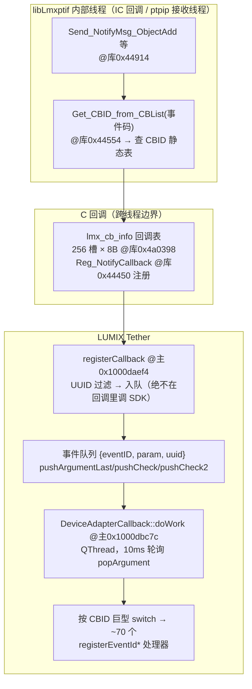

# 02 · 事件回调系统与 CBID 全表

> 这是整个 tethering 架构的中枢：拍照完成、卡插入、失联、电量变化……全部经这套机制上抛。

## 1. 三层架构



## 2. 注册：97 项 / 78 个事件

`DeviceAdapterCallback::CallbackRegist` @主`0x1000da8cc`（源：`decompiled/DACB_CallbackRegist_da8cc.c`）——OpenSession 成功后调用，**97 次** `adp_Reg_NotifyCallback`（对应库 `LMX_func_api_Reg_NotifyCallback @0x44450`），实际覆盖 **78 个不同事件 ID**（部分事件多设备各注册一次）。反注册为 `CallbackUnRegist @0x10000db820`。

库侧行为（@库`0x44450`）：

- 在 `lmx_cb_info`（`0x4a0398`，2048B = **256 槽 × 8B**）里查重；空槽标记 `0xFFFFFFFF`（静态映像全空 = 运行时填充）。
- 新事件 → `Add_CallBackInfo` 挂回调指针；**已注册返回 `0x20003`**（booth 的 `r != 131075` 容错正是处理它）。
- 表满（>255）返回 `0x20004`。

PTP/IP 通道有独立注册路径 `registerCallback_PtpIp @主0x1000db5e4`。

## 3. 回调入口：只入队，不碰库

`registerCallback` @主`0x1000daef4`（源：`decompiled/DACB_registerCallback_daef4.c`）：

```c
int registerCallback(uint32_t cbid, uint32_t param, char* uuid) {
    // ① 按当前选中相机的 UUID strcmp 过滤——非选中相机的事件直接丢弃
    //    （固件升级模式 / multiview 模式有特判分支）
    // ② pushArgumentLast / pushCheck / pushCheck2 入队 {eventID=cbid, param, uuid拷贝}
    //    pushArgumentLast 对同类事件做去重合并（如 DevicePropChanged 连发只留最新）
    return 0;
}
```

**移植铁律**（booth `LmxEventRouter` 已遵守）：C 回调运行在库内部线程，任何 SDK 调用都禁止在回调里发生——官方在这里连字符串都要拷贝后才入队。

## 4. 消费线程：10ms 轮询 + 巨型 switch

`DeviceAdapterCallback::doWork` @主`0x1000dbc7c`（源：`decompiled/DACB_doWork_dbc7c.c`）：

```c
// QThread::run 语义
for (;;) {
    if (IsInterruptionRequested()) break;      // @0x1000da048
    if (popArgument(&arg)) {                    // @0x1000da72c
        switch (arg.eventID) {
        case 0x10000040: registerEventIdObjectAdd(arg.param, ...);      // @0x10003f588
        case 0x10000043: /* ObjectReqTransfer → ObjectReqTransfer::saveObject */
        case 0x20000A0:  registerEventIdStillImageInfo(...);            // @0x10003b470
        case 0x10000010: /* 设备失联 */
        // ... 共 ~70 个 registerEventId* 处理器
        }
    }
    nanosleep((0, 10000000));   // 10ms
}
```

处理器命名（nm 符号 + 反编译文件名）可反推语义，本目录 `decompiled/` 中可见：`registerEventIdObjectAdd`、`registerEventIdStillImageInfo`、`registerEventIdLiveViewComposite`、`registerEventIdNotifyError`、`registerAddEventReceivedNotify`、`registerRecWithNoSd`（**无卡拍摄**专用回调）等。

## 5. 库侧事件产生：11 个 Send_NotifyMsg_* 出口 + CBID 查表

**权威映射表**（全部经 IDA 反编译逐个验证，key = `Get_CBID_from_CBList` 的入参，全部条目命中静态表后恒等映射回自身）：

| 库出口函数（arm64 地址） | key / CBID | param 含义 |
|---|---|---|
| `Send_NotifyMsg_StoreAdded` @0x445f4 | `0x10000000` | storageID |
| `Send_NotifyMsg_StoreRemoved` @0x446fc | `0x10000001` | storageID |
| `Send_NotifyMsg_StorageInfoChanged` @0x44808 | `0x10000002` | storageID |
| `Send_NotifyMsg_ObjectAdd` @0x44914 | `0x10000040` | object handle |
| `Send_NotifyMsg_ReqObjTrnsfer` @0x44d3c | `0x10000043` | object handle |
| `Send_NotifyMsg_DataTransferProgress` @0x450c4 | **`0x11000000`** | 进度值 |
| `Send_NotifyMsg_Device_Stray` @0x44ba4 | **`0x1FF20001`** | —（固件升级中先走 fwup 分支再回调） |
| `Send_NotifyMsg_Device_Reset` @0x44c88 | **`0x1FF20003`** | — |
| `Send_NotifyMsg_4K6K_Data_Ready` @0x44a20 | `0x1FF10000` | — |
| `Send_NotifyMsg_Change_Notify_Info` @0x44ae4 | **动态**：a2 = 相机上报的原始事件码直接查表 | a2 |
| `Send_NotifyMsg_Vendor_Event` @0x44df8 | **动态**：a2 = vendor 事件码查表 | a2（回调第二参数传原始事件码） |

后两个动态出口是静态表里庞大事件家族（0x0200xxxx/0x1001xxxx 等）的触发路径：相机经 PTP Event/DevicePropChanged 上报什么码，库就拿什么码查表后回调。

调用形态（StoreAdded 反编译可见）：`v9(cbid, param, uuid栈上 strcpy 拷贝)`——即 `cb(cbid, param, uuid拷贝)`，与 booth `LmxEventRouter` 的处理一致（uuid 必须当场拷贝）。

`Get_CBID_from_CBList` @库`0x44554` 的查表规则：

- 事件码落在 devprop 区间（`0x1FFxxxxx` 一带 / `0x1001xxxx` 设备属性族）→ 查 `lmx_tbl_cbid_devprop_list`（@库`0x267ac8`，62 条）。
- 其余 → 查 `lmx_tbl_cbid_list`（@库`0x266e08`，272 条）。
- 条目布局 **12 字节**：`{u32 key(内部事件码); u32 cbid(主); u32 flag}`。
  - 绝大多数条目 `cbid == key`（恒等映射）；第三字段静态恒为 0。
  - **devprop 族条目例外**：主 cbid 为具体属性 ID，备用值为组回调 `0x10015000`（选择逻辑在 `Get_CBID_from_CBList` 内，实机实测以收到的 CBID 为准）。

## 6. CBID 静态表完整 dump（v2.12 库，arm64）

### 6.1 已确认语义的事件（11 个出口函数直接证据 + booth 实测）

| CBID | 语义 | param 含义 | 证据 |
|---|---|---|---|
| `0x10000000` | StoreAdded 存储卡插入 | storageID | 出口函数硬编码 + booth 真值表 |
| `0x10000001` | StoreRemoved 存储卡拔出 | storageID | 出口函数硬编码 + booth 真值表 |
| `0x10000002` | StorageInfoChanged 存储信息变更 | storageID | 出口函数硬编码 + booth 真值表 |
| `0x10000040` | **ObjectAdded 照片落卡** | **object handle** | `Send_NotifyMsg_ObjectAdd` 硬编码 |
| `0x10000043` | **ObjectReqTransfer（“PC 保存”模式请求传输）** | handle | `Send_NotifyMsg_ReqObjTrnsfer` 硬编码（日志串 "EventID:0x10000043"） |
| `0x11000000` | **DataTransferProgress 下载进度** | 进度值 | `Send_NotifyMsg_DataTransferProgress` 硬编码 |
| `0x1FF20001` | **DeviceStray 相机拔出/失联（库内常量路径）** | — | `Send_NotifyMsg_Device_Stray` 硬编码 |
| `0x1FF20003` | **DeviceReset 相机复位** | — | `Send_NotifyMsg_Device_Reset` 硬编码 |
| `0x1FF10000` | 4K/6K 数据就绪 | — | `Send_NotifyMsg_4K6K_Data_Ready` 硬编码 |
| `0x10000010` | DeviceStray（**booth USB 实测收到**） | — | 实测；可能经 Change_Notify_Info 动态路径产生（静态表内存在该条目） |
| `0x20000A0` | StillImageInfo 静态图像信息 | — | 官方 `registerEventIdStillImageInfo` |
| `0x10015001..0x1001502C` | DevPropChanged（标准 PTP 属性 0x5001-0x502C：电量 0x5001 等） | 属性值 | devprop 表 |
| `0x1001D001..0x1001D110` | DevPropChanged（松下 vendor 属性） | 属性值 | devprop 表 |

⚠ booth `LmxTypes.swift` 现有 `deviceReset=0x10000001` **与 StoreRemoved 撞值**（真值是 `0x1FF20003`）——相机复位事件会被误判为拔卡；`reqObjTransfer=0x10000100` 不存在（真值 `0x10000043`）；`dataTransferProg=0x10000081` 不在静态表（常量路径真值 `0x11000000`）。见 06 §E6。

### 6.2 `lmx_tbl_cbid_list`（@0x266e08，272 条，按 key 前缀分组）

除上表已标注者外，全部条目 `cbid == key`（恒等映射）。分组罗列（`x` 为通配）：

```
0x0100 0010-0016        （7 条）
0x0200 0010-001F        0x0200 0020-0022, 0025
0x0200 0030-0034        0x0200 0040-0042
0x0200 0050-0055        0x0200 0060-0062        0x0200 0070-0079
0x0200 0080-0088        0x0200 00A0-00A6        0x0200 00B0-00B2
0x0200 00C0             0x0200 00E0-00EC（无 00E6）
0x0200 0110-011B        0x0200 0120-0126        0x0200 0140-0141
0x0200 0170-0173        0x0200 01A0-01A1        0x0200 01B0-01BC
0x0200 01C0-01C2        0x0200 01D0-01D5        0x0200 01E0-01E3
0x0200 01F0-01FA
0x0500 0011
0x0600 0010-001B（无 0016,0017）
0x0700 0011-0013
0x0800 0010-001A        0x0800 0050-0052        0x0800 0070-0073
0x0800 0090-0091        0x0800 00A0-00A2        0x0800 00B0-00B4
0x0E00 0011             0x0E00 0020-0021
0x1100 0000
0x1200 0010-001D        0x1200 0020-0027        0x1200 0070-0072
0x1201 0040-0044        0x1201 00A0-00A5
0x1280 0040-0042        0x1280 0110-0113
0x15C0 0010-0012        0x1600 0010-0011        0x1800 0010-0011
0x1FF1 0000             0x1FF2 0001, 0003
0x1000 0000-0002        0x1000 0040-0043        0x1000 0080, 0090
0xFF00 0000             （哨兵/终止标记）
```

表内存在少量重复条目（`0x2000050-55`、`0x2000120-124`、`0x8000090-91`、`0x1200001D` 各出现两次）——疑似不同固件代的兼容追加，`Get_CBID_from_CBList` 顺序命中即返回。

### 6.3 `lmx_tbl_cbid_devprop_list`（@0x267ac8，62 条）

```
key 0x10015001 .. 0x1001502C   （标准 PTP DevProp 0x5001..0x502C，44 条）
key 0x1001D001, 0x1001D002     （vendor DevProp）
key 0x1001D102 .. 0x1001D110   （vendor DevProp，15 条）
key 0x1001FFFF                 （通配 DevProp 终止标记）
全部条目备用值 = 0x10015000（组回调），flag=0
```

### 6.4 命名规律

CBID = `0x{类别}{PTP 码}`：类别 nibble 标识来源（`0x1000`=核心对象/存储事件、`0x1001`=设备属性、`0x0200`=状态/能力族、`0x1200`/`0x1280`=录像/媒体族……），低位即 PTP 事件码或 vendor 码。据此遇到未知 CBID 时可按 `低 20bit` 对照 PTP 标准事件码猜语义，再用注册实验验证。

### 6.5 与 booth 常量的对照勘误（11 出口函数逐个验证后的最终结论）

| booth 常量（LmxTypes.swift） | 库内真值 | 结论 |
|---|---|---|
| `storeAdded=0x10000000` | 0x10000000 | ✅ 正确 |
| `storeRemoved=0x10000001` | 0x10000001 | ✅ 正确 |
| `storageInfoChanged=0x10000002` | 0x10000002 | ✅ 正确 |
| `objectAdded=0x10000040` | 0x10000040 | ✅ 正确 |
| `deviceStray=0x10000010` | 常量路径 0x1FF20001；0x10000010 为 USB 实测值 | ⚠ 双路监听更稳 |
| `deviceReset=0x10000001` | 0x1FF20003 | ❌ **与 StoreRemoved 撞值，必须修** |
| `reqObjTransfer=0x10000100` | 0x10000043 | ❌ 修 |
| `dataTransferProg=0x10000081` | 常量路径 0x11000000 | ⚠ 建议双监听验证 |

`lmx.py` 旧值（`0x10000100`/`0x0E000257`/`0x0E000254`）同样作废。

## 7. 移植要点小结

1. booth 的「C 回调 → LmxEventRouter → actor Task 投递」结构等价于官方的「回调入队 → QThread 消费」，方向正确。
2. 官方对同类事件做**去重合并**（pushArgumentLast），booth 的 AsyncStream 天然背压，但 `refreshStatus` 的 Task 重复投递可借鉴去重。
3. 官方在回调里按**选中相机 UUID 过滤**多机位事件；booth 单机位天然满足。
4. 想监听电量变化（替代轮询 `GetBatteryInfo`），可注册 devprop 族 `0x10015001`（BatteryLevel）实验；官方即走此路（62 条 devprop 表全部注册过）。
5. 10ms 消费轮询 vs booth 的即时 Task：booth 延迟更低，无问题。
