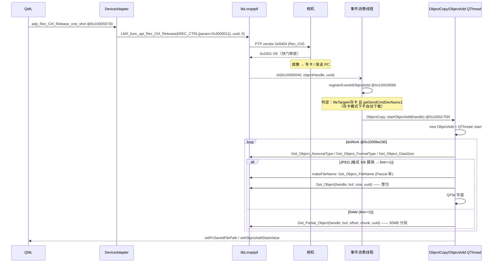

# 04 · 拍照与照片下载流程

> 官方的拍摄是「vendor 命令 + 事件驱动下载」两段式；下载分 JPEG 整包与 RAW 分段两条路径，由格式探测自动选择。



## 1. 拍照命令族（REC_CTRL）

全部经 `LMX_func_api_Rec_Ctrl_Release(REC_CTRL*, uuid, err)` @库`0x436f0` 下发，PTP vendor opcode `0x9404`（见 05 §4.1）。官方使用的 param 值：

| 操作 | 函数 | param | 备注 |
|---|---|---|---|
| **单张全按** | `adp_Rec_Ctrl_Release_one_shot @0x100059730` | `0x3000011` (50331665) | multiview 时对所有选中相机重复发送（同步拍） |
| 半按开始 | `halfs_start @0x10005cc48` | `0x3000018` (50331672) | 对焦/测光 |
| 半按结束 | `halfs_end @0x10005d3d0` | 对应结束码 | |
| 连拍开始/结束 | `cont_start @0x100059ee4` / `cont_end @0x10005a6a0` | 连拍码 | |
| 4K 连拍 | `4k_burst_start/stop @0x10005db58/0x10005e314` | | |
| 单次 AF/AE | `adp_rec_Ctrl_AfAe_af_onesht @0x100066518` | | |

`adp_Rec_Ctrl_Release_one_shot` 的调用形态（源：`decompiled/adp_Rec_Ctrl_Release_one_shot_59730.c`）：

```c
uint8_t v57[0x808];        // REC_CTRL 结构按 0x808 预留（参数数组很长）
bzero(&v57, 0x808);
*(uint32_t*)&v56 = 50331665;    // param = 0x3000011
// n_params = 0
LMX_func_api_Rec_Ctrl_Release(&ctrl, uuid, 0);
```

**注意**：booth 目前用 `StilLCapture_Single`（@库`0x19604`）拍照——官方主程序**从未调用**该符号（全量 xref 验证）。它能工作，但属于库暴露的未在官方路径上验证的便捷封装；REC_CTRL 路线才是官方语义（且能带 AF/AE 精控、连拍、多机位同步）。移植建议见 06 §E2。

## 2. 拍照期间 LiveView 怎么办？

官方**不暂停**取帧线程：`LiveGetThreadFunc` 一直轮询，`ObjectAdd` 下载线程与它并发跑，靠 `DeviceAdapter` 的 per-device 互斥锁把每次 SDK 调用串行化。相机在成像瞬间常返回 BUSY(0x40004)，取帧循环自然降频。详见 06 §E1 的移植讨论。

## 3. 事件触发下载：fileTarget 判定

`registerEventIdObjectAdd` @主`0x10003f588`（源：`decompiled/DA_registerEventIdObjectAdd_3f588.c`）：

```c
void registerEventIdObjectAdd(uint32_t cbid, uint32_t handle, char* uuid) {
    if (cbid == 268435520 /*0x10000040*/) {
        // 仅当：本次发拍照命令的相机数 ≤ 1 && fileTarget ≠ 1（非"只存卡"）/ 无卡模式
        if (getSendCmdDevNum() <= 1 && (fileTarget != 1 || isNoCardMode())) {
            ObjectCopy::startObjectAdd(handle, uuid);
        }
    }
}
```

即**自动下载只发生在「保存目标含 PC」或「无卡拍摄」时**；纯存卡模式靠用户手动选图走 `ObjectReqTransfer`（"PC 保存" 事件 `0x10000043`，处理器 `@0x1000c33f8` 的 saveObject）。无卡模式另有专用回调 `registerRecWithNoSd @0x100045784`。

## 4. 下载线程：ObjectCopy / ObjectAdd

**启动** `ObjectCopy::startObjectAdd` @主`0x1000c7f30`（源：`decompiled/OC_startObjectAdd_c7f30.c`）：

```c
Get_Object_FormatType(handle, &fmt, uuid, &err);
if (fmt == 5 || fmt == 6) {                  // 静态图像格式（EXIF/JPEG 与 RAW 探测位）
    Get_Object_DataSize(handle, &size, uuid, &err);
    ObjectAdd* oa = new ObjectAdd(0x78);     // 结构体 0x78 字节
    QThread* t = new QThread;
    oa->moveToThread(t);
    connect(t, &QThread::started, oa, &ObjectAdd::doWork);
    connect(oa, &ObjectAdd::finished, t, &QThread::quit);
    t->start();
}
```

队列辅助：`pushData @0x1000c1ab0` / `popData @0x1000be384`（连拍时多张排队下载）。

**JPEG 路径** `ObjectAdd::saveObject` @主`0x1000c2284`（源：`decompiled/ObjectAdd_saveObject_c2284.c`）：

```c
Get_Object_AssociatType(handle, &assoc, uuid, &err);      // 关联类型（多帧合成等）
Get_Object_FormatType(handle, &fmt, uuid, &err);
Get_Object_DataSize(handle, &size, uuid, &err);
name = ObjectCopy::makeFileName(handle, fmt, uuid);       // @0x1000beb58
QByteArray ba; ba.resize(size);
adp_Get_Object(handle, ba.data(), size, uuid);            // 【整包一次性下载】
QFile f(path); f.open(QIODevice::WriteOnly); f.write(ba); f.close();
if ((fmt == 1 /*JPEG*/ || fmt == 2 /*RAW*/) && assoc == 无关联)
    setPcSavedFilePath(path);                             // 通知 UI "已保存到 PC"
```

**RAW 路径** `ObjectAdd::saveRAW` @主`0x1000c1b64`（源：`decompiled/ObjectAdd_saveRAW_c1b64.c`）：

```c
const uint32_t CHUNK = 31457280;              // 30MB
QByteArray buf(CHUNK, 0);
uint64_t offset = 0, remaining = totalSize;
while (remaining > 0) {
    uint32_t chunk = (remaining >> 21) > 14 ? CHUNK : (uint32_t)remaining;
    // 即：剩余 > ~29.4MB 用 30MB 块，否则整块收尾
    adp_Get_Partial_Object(handle, buf.data(), offset, chunk, uuid);   // @库0x18b40
    file.write(buf, chunk);
    offset += chunk;  remaining -= chunk;
    if (IsInterruptionRequested()) { ... }    // 支持中断
}
```

**文件名** `ObjectCopy::makeFileName` @主`0x1000beb58`：`Get_Object_FileName` 返回 **Pascal 串**（`{u8 len; char s[257]}`，即 booth `LmxPTPArrayString` 的布局）；**无卡拍摄**时相机不提供文件名，官方兜底名 `CARDLESS.JPG` / `CARDLESS.RW2`。另有 `Get_Object_AssociatDesc @0x1000717b8`（关联描述）。

**进度/取消**：`dataTransferProg` 事件族驱动进度条；`ClearInterruption @0x1000beaf8` / `IsInterruption @0x1000c1998` 支持用户取消。

**录像路径**：`ObjectAdd::saveMovie @0x1000be514` + `ObjectCopy::setMovieHandle @0x1000be4fc`（booth 不涉及）。

## 5. 与 booth `capture()/downloadObject()` 的对照

| 官方行为 | booth 现状 | 评估 |
|---|---|---|
| REC_CTRL{0x3000011} 拍照 | `StilLCapture_Single` | 能用但非官方路径，建议切换（见 06） |
| ObjectAdded 触发下载 | 同（`waitObjectAdded`） | ✅ 一致 |
| 先探测格式再选下载路径 | 直接按 DataSize 整包 | JPEG 场景等价；RAW 需要分段（见 06） |
| Get_Object 整包（JPEG） | 同 | ✅ 一致 |
| 30MB 分段 Get_Partial_Object（RAW） | 未实现 | RAW 支持时必须补 |
| makeFileName Pascal 串 + CARDLESS 兜底 | `P\d+.JPG` 兜底 | 语义等价，可加 CARDLESS 语义 |
| 拍照期间不暂停 LiveView | `libraryBusy` 暂停取帧 | 见 06 §E1 讨论 |

## 6. 移植要点小结

1. RAW/大文件：`Get_Partial_Object`（符号 `_Z33LMX_func_api_Get_Partial_ObjectjjPjjPcS_`? 实际 mangled：`_Z33LMX_func_api_Get_Partial_ObjectjPhjjPcS_`，@库`0x18b40`，签名 `(handle, buf, offset, chunk, uuid, err)`；另有 `Get_Partial_ObjectEx @0x11e18` 带更多控制）。分段规则照抄官方：`chunk = remaining > 29360128 ? 31457280 : remaining`。
2. 无卡拍摄（`registerRecWithNoSd` 路径）若要支持：检测 `fileTarget` + 无卡回调，文件名兜底 CARDLESS。
3. 连拍排队：官方一个 `ObjectAdd` 线程 + `pushData/popData` 队列顺序下载多张；booth 目前单张闭环，扩展连拍时照抄。
4. 下载前先 `Get_Object_FormatType` 分流 JPEG/RAW，再决定整包/分段——不要对 RAW 用整包 `Get_Object`（大缓冲 + 库内超时风险）。
