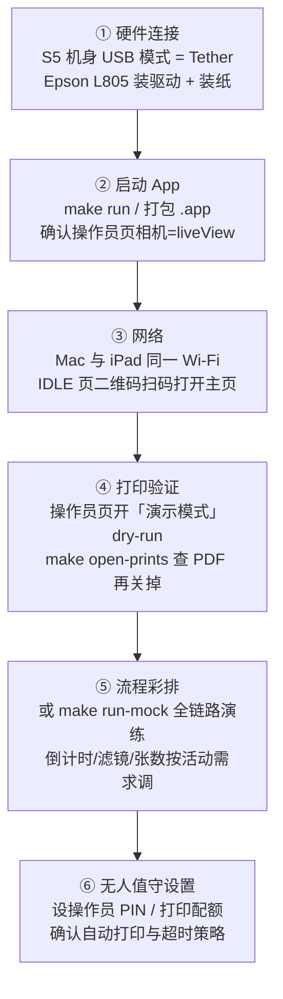

# 现场运营与部署指南

> 面向活动前部署与现场操作员。功能细节见 [photoflow.md](photoflow.md) 与 [server-api.md](server-api.md)。

## 1. 活动前部署清单



## 2. 操作员页速查

Esc 退出宾客大屏全屏进入操作员页；设置了 PIN 时需输码（恒定耗时校验，防暴力猜解）。四个标签页：

| 标签 | 内容 |
|---|---|
| 状态 | 相机连接/电量、打印队列（重试/清除）、健康卡片、流程状态 |
| 设置 | 拍摄模式与倒计时、修图开关与强度、主题选择、装饰模板、打印设置（份数/纸张/无边距/dry-run）、服务端口、灵敏度、提示音 |
| 历史 | 会话列表，成片重打、导出 |
| 日志 | 运行日志查看（文件另存 `~/Library/Logs/Booth/`） |

宾客大屏快捷键：`空格` 手动开拍 · `R` 重拍 · `P` REVIEW 直接打印 · `Esc` 退出全屏。

## 3. 关键配置项

配置落盘 `~/Library/Application Support/Booth/config.json`，操作员页修改即时热更新。十大节 `camera / capture / vision / imaging / printing / server / security / sounds / share / guestbook`，全部字段可缺省（向后兼容）。常用项：

| 配置 | 默认 | 说明 |
|---|---|---|
| `capture.countdownSec` | 3 | 倒计时秒数 |
| `capture.defaultMode` | collage(4) | 开拍默认模式 |
| `capture.reviewTimeoutSec` | 60 | REVIEW 超时 |
| `capture.autoPrintOnTimeout` | true | 超时自动打默认张数（防宾客误触发可关） |
| `capture.idleCooldownAfterPrintSec` | 0 | 打印完成后待机冷却（防上一批宾客滞留误触） |
| `capture.idleDimAfterMin` | 10 | 无人操作大屏变暗（省电） |
| `imaging.skinStrength` | 50 | 美肤强度 |
| `imaging.replaceBackground` | false | 换背景开关 |
| `imaging.decorationTemplate` | "" | 装饰模板名（空=关） |
| `imaging.generateGIF` | true | Boomerang 动图 |
| `printing.defaultCopies` | 2 | 默认张数（可选 1–4） |
| `printing.borderless` | true | 6 寸无边距 |
| `printing.printQuotaPerHour` | 0 | 每小时打印配额（0=不限，防纸张打穿） |
| `printing.dryRun` | false | 打印演示模式（落 PDF 不送打印机） |
| `security.quitProtection` | true | 退出保护 |
| `sounds.*` | — | 提示音（倒计时/快门/完成） |

## 4. 无人值守防呆

活动人多时建议全开：操作员 PIN（配置防篡改 + 进操作员页门禁）、打印配额、打印去重（同一成片 5s 内只入队一次）、退出保护、REVIEW 超时策略按需选择（自动打印 vs 只回待机）、打印后待机冷却。极端情况下"一键重置"可恢复默认配置，PIN 哈希独立存储不会被冲掉。

## 5. 主题与装饰素材

主题控制 UI 配色与图标，装饰模板控制大头贴贴纸/形变：

```bash
# 安装内置婚礼主题到运行时目录（操作员页主题名填 cream-wedding 启用）
make install-theme
```

- 主题：`assets/themes/cream-wedding/`（theme.json 配色 + icons/ 图标），安装后落 `~/Library/Application Support/Booth/themes/`
- 装饰模板：`assets/decorations/` 自带 5 套（wedding-chinese 双囍 / wedding-fun 礼帽胡子 / wedding-elegant 头纱 / wedding-comic 眼镜 / wedding-sweet 戒指），用 `swift tools/InstallDecorations.swift <目录>` 安装
- 自制模板：`decorations/<名>/template.json` + 贴纸 PNG，人脸关键点区域（眼睛/唇/脸颊…）见 `FaceGeometry.Region`

## 6. 无硬件演示与彩排

```bash
make run-mock       # 合成相机 + 视觉自动命中 + 打印落 PDF
make run-mock-app   # .app 形态（可被自动化工具驱动）
make open-prints    # 打开 dry-run PDF 输出目录
```

Mock 模式下空格/点击开始即自动走完整链路，review 超时自动循环——适合活动前给主办方演示全流程，或开发时无相机调试。

## 7. 故障排查

| 症状 | 排查 |
|---|---|
| 枚举不到相机 | 机身 USB 模式是否为 Tether；换线/换口；`python3 lmx.py` 单测链路 |
| LiveView 卡顿 | USB 带宽正常 10–30fps，属预期；检查是否被其他 App 占用相机 |
| 拍照超时进 failure | 看 `make log` 是否有 ObjectAdded 超时；存储卡余量 |
| 打印缺纸/脱机 | 操作员页队列任务标红，处理后点重试；健康卡片看 lpstat 详情 |
| 手势不灵 | 现场逆光/暗光会影响 Vision；调低灵敏度阈值或直接用空格兜底 |
| iPad 打不开页面 | 确认同一 Wi-Fi、端口未被占用；大屏 IDLE 页二维码与操作员页端口一致 |
| App 异常退出 | `health.json` 有最后一次健康快照；日志在 `~/Library/Logs/Booth/` |

## 8. 已知边界与风险

- `libLmxptpif.dylib` 为逆向所得非公开 API：LUMIX Tether 升级可能变签名（v2.12 实测可用）；自用风险低，商用需评估 EULA；最坏情况按已还原的 PTP opcode 自实现传输层
- 不同 macOS 版本对 Epson 无边距预设支持有差异：部署时务必先 dry-run + 真机各验一次；不达预期可降级有边距居中（`printing.borderless=false`）
- 视频留言簿使用 Mac 内置摄像头，与 LUMIX 拍照机相互独立，两者不冲突
- v1 明确不做：视频成片/多相机管理/曝光参数调节/云端相册（SPEC §13）
