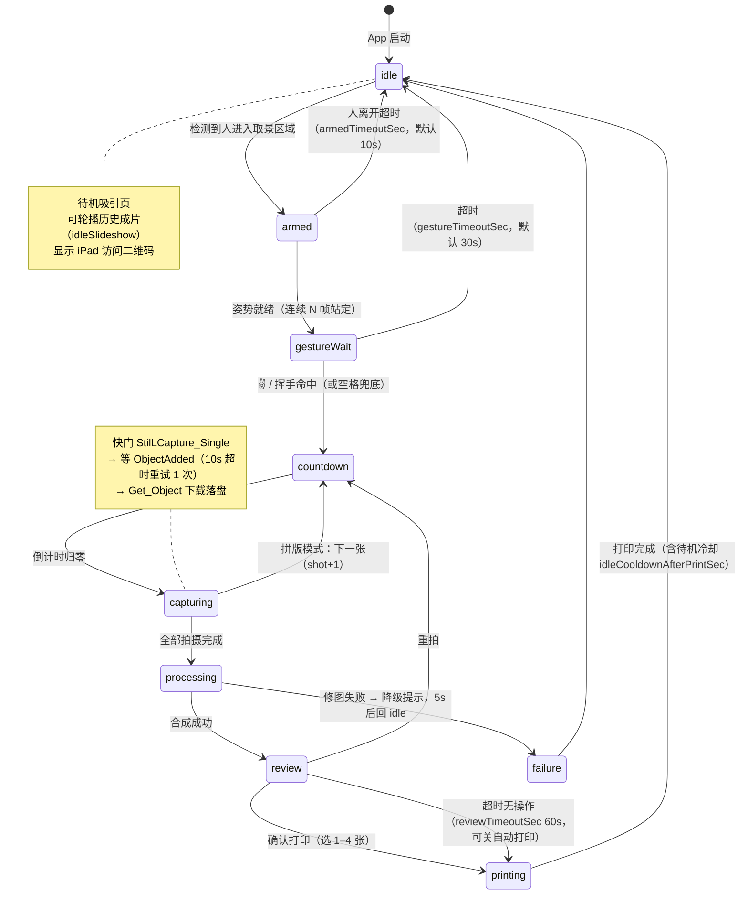
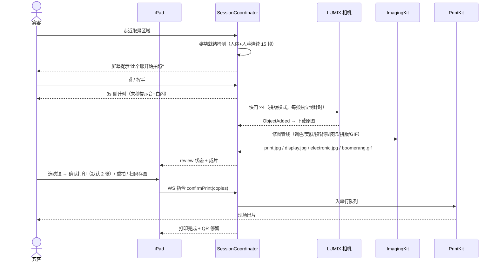
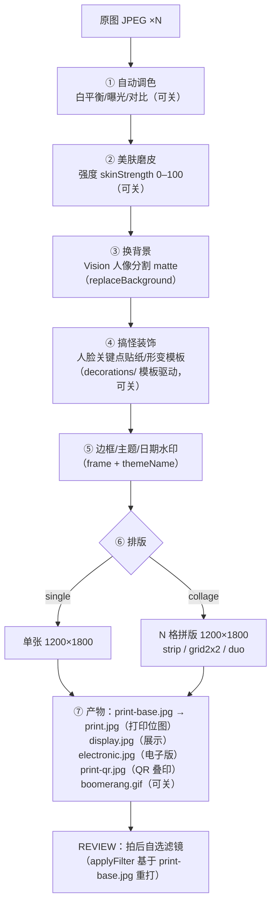

# 拍照流程与状态机

> 核心实现在 [Sources/SessionEngine/SessionCoordinator.swift](../Sources/SessionEngine/SessionCoordinator.swift)。状态定义见 [BoothCore/Models.swift](../Sources/BoothCore/Models.swift) 的 `BoothState`。

## 1. 状态机总览

每次转移同步四路：日志 / 内部状态流 / EventBus / BoothServer WebSocket 广播——大屏与 iPad 永远同屏。

## 2. 宾客完整时序

手动兜底：空格键 = 与手势命中完全等价的开拍；REVIEW 态 `P` 键直接按默认张数打印。

## 3. 拍摄模式

模式在 IDLE 页点选，默认 `collage(4)`（可配置 `capture.defaultMode`）：

| ShootKind | CollageLayout | 张数 | 版面 |
|---|---|---|---|
| `single` | — | 1 | 单张直出 6 寸 |
| `collage` | `strip` 经典拼条 | 4 | 4 格纵列 + 底部品牌条 |
| `collage` | `grid2x2` 四宫格 | 4 | 2×2 宫格 |
| `collage` | `duo` 双格大图 | 2 | 上下两格 |

拼版模式每次倒计时独立，间隔显示"还有 N 张"；开启 `capture.continuousCollage` 可拍完自动回 idle 连续开拍（多人排队场景）。

## 4. 修图合成管线（PROCESSING）

管线各步配置驱动、可独立开关，**任一步失败降级跳过不阻断**：

要点：`print-base.jpg` 是未滤镜未边框的底图，REVIEW 态换滤镜重打时基于它重新生成，产物换新 id 避免 iPad 浏览器缓存；GIF（Boomerang）在拼版模式下自动生成，QR 码优先指向 `.gif`。

## 5. 防抖与降级

| 环节 | 策略 |
|---|---|
| 姿势就绪 | 人体+人脸同帧检测，连续命中（默认 15 帧 ≈0.5s）才转 gestureWait |
| 手势 | ✌️ / 张开手掌连续命中 5 帧；现场光线复杂时空格键兜底 |
| 拍照 | 10s 未收 ObjectAdded 自动重试 1 次，仍失败进 failure 态（展示 5s 后回 idle，记日志） |
| 修图 | 单步失败跳过该步继续；全失败降级原图+边框 |
| 相机断线 | 事件/错误触发后指数退避重连，恢复自动重启 LiveView 回 idle |
| 连点防呆 | 同一成片 5s 内重复打印指令去重（printing.dedupeWindowSec） |

Vision 检测全部本地推理（Apple Vision），无网络依赖；灵敏度（连续帧数、面积阈值）入 `vision` 配置节。
