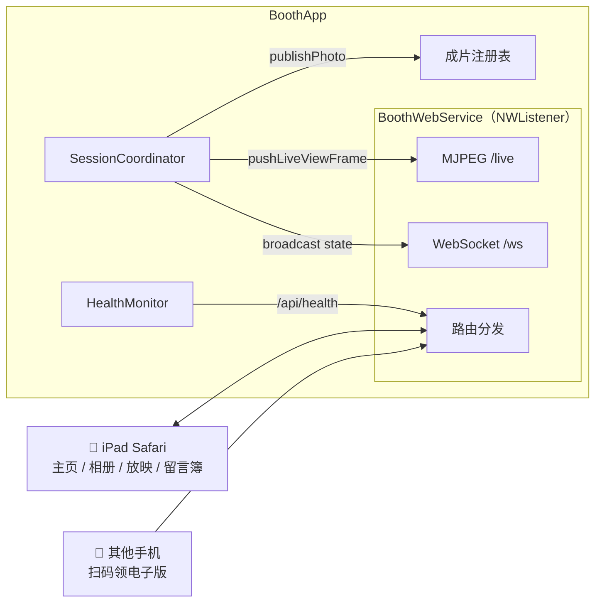
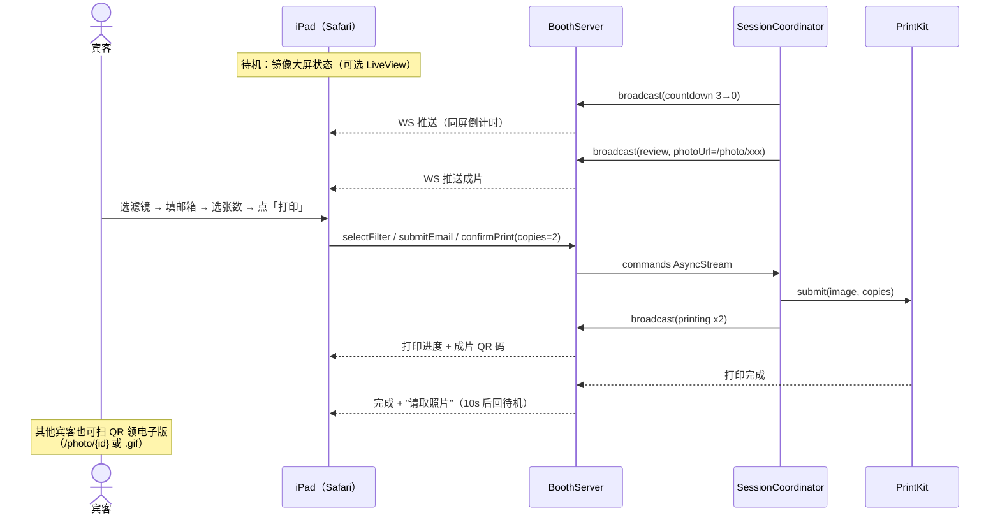

# iPad Web 服务与接口

> 实现在 [Sources/BoothServer/](../Sources/BoothServer/)：基于 Network.framework 手写的轻量 HTTP + WebSocket 服务（零第三方依赖）。服务随 App 启动拉起，端口默认 8080（`server` 配置节可改），大屏 IDLE 页常驻显示访问二维码。

## 1. 服务架构

- **下行**：状态广播（`state` 含倒计时读秒、拍摄进度、成片 URL、打印队列）、MJPEG 实时取景（内部降频丢帧）
- **上行**：iPad 指令（确认打印/重拍/选模式/选滤镜/留邮箱/操作员重打），由 SessionCoordinator 的指令消费任务统一处理

## 2. HTTP 路由

| 路由 | 说明 |
|---|---|
| `GET /` | iPad 主页（单页应用，静态资源内嵌 App Bundle） |
| `GET /live` | LiveView MJPEG 流（`multipart/x-mixed-replace`，Safari 原生支持） |
| `GET /photo/{id}` | 成片电子版下载（QR 码指向此地址） |
| `GET /photo/{id}.gif` | Boomerang 动图（拼版模式生成，QR 优先指向） |
| `GET /photo/history/{date}/{session}` | 历史成片（相册/放映/操作员重打用） |
| `GET /api/photos` | 最近成片 JSON 清单（相册/放映页数据源） |
| `GET /api/health` | 健康快照 JSON（相机/打印机/磁盘/采集数） |
| `GET /api/emails` | 邮箱采集列表（操作员远程查看线索） |
| `GET /api/guestbook` | 视频留言簿清单 |
| `GET /guestbook/video/{name}` | 留言簿视频回放 |
| `GET /gallery` | iPad 相册页（历史成片宫格） |
| `GET /slideshow` | 放映页（全屏自动轮播，接大屏或另一台 iPad） |
| `GET /theme/icon/{name}` | 主题图标（主题化图标系统） |
| `WS /ws` | WebSocket：状态下行 + iPad 指令上行 |

## 3. WebSocket 消息

下行（服务端 → iPad，随状态转移推送）：

| 字段 | 说明 |
|---|---|
| `state` | 流程状态与读秒（idle / countdown 3..0 / capturing 2/4 / review / printing x2 / …） |
| `photoUrl` | REVIEW 态成片地址（`/photo/{id}`） |
| `gifUrl` | Boomerang 地址（如有） |
| `queueInfo` | 打印队列深度与状态 |

上行（iPad → 服务端，`iPadCommand`）：

| action | 参数 | 说明 |
|---|---|---|
| `confirmPrint` | `copies: 1–4` | 确认打印 |
| `retake` | — | 重拍（回 countdown） |
| `selectMode` | 模式 | IDLE 态选单张/拼版 |
| `selectFilter` | 滤镜 | REVIEW 态拍后自选（换滤镜重打） |
| `submitEmail` | `email, photoID` | 邮箱线索采集（仅落盘，不发送） |
| `operatorReprint` | `code, date, session` | 相册页验口令后的补打 |

## 4. 一轮完整交互

## 5. 健康与远程监控

`/api/health` 返回 `HealthMonitor` 周期采样的快照：相机状态、打印机状态（`lpstat` 探测）、磁盘余量、当前流程状态、邮箱采集数与整体 `ok` 判定；快照同时落盘 `health.json`（进程崩溃后仍可查最后一次）。活动期间用手机浏览器打开即可远程巡检，同一份数据也显示在操作员页健康卡片。

## 6. 配套 iPad 页面

- **主页 `/`**：待机动画 → 倒计时镜像 → REVIEW 全屏成片（打印/重拍/存图）→ 打印进度
- **相册 `/gallery`**：历史成片宫格，支持口令补打
- **放映 `/slideshow`**：全屏轮播历史成片（接一块备用屏当展示墙）
- **留言簿 `/guestbook`**：调用 Mac 内置摄像头录制祝福短视频，回放页 CSS 覆盖祝福语（非烘焙进视频，换文案不用重录）
